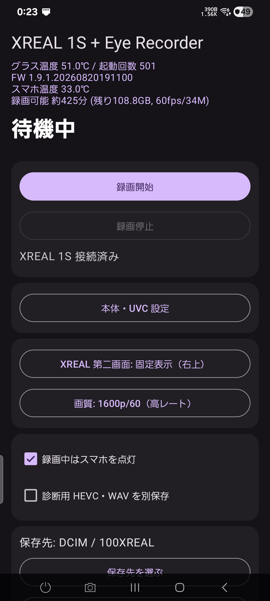

# XREAL 1S Eye Capture (Android)

XREAL 1S（XREAL Eye 搭載グラス）の映像・音声・IMU（ジャイロ）データを Android 端末単体で録画・記録するネイティブアプリ（`XREAL Recorder`）です。



## 概要

XREAL 1S から USB-C 経由で映像ストリーム・USB オーディオ・IMU データを取得し、Gyroflow 対応の `gyrf` トラックを含む MP4 ファイルとして保存します。

- **2系統の映像入力**: USB Ethernet 経由の TCP ストリームと、USB Host API による UVC Bulk 転送（`2048×1512` HEVC）の両方に対応しています。
- **クラッシュセーフな録画**: ネイティブライブラリ（`libgyroflow_inject.so`）を用いた Fragmented MP4（fMP4）の単一書込みにより、録画中にアプリが強制終了した場合でも直前までの映像・音声・ジャイロデータが破損せず残ります。
- **Gyroflow 連携（`gyrf` トラック内蔵）**: 録画中の IMU データを MP4 内の `gyrf`（`bin_data`）トラックへ格納し、`gyro2bb` 等で `XREAL 1S` として認識・手ブレ補正できます。
- **USB オーディオ & 波形表示**: XREAL の USB オーディオを優先選択して AAC（48 kHz / モノラル）で格納し、本体画面および外部ディスプレイ（`Presentation`）にリアルタイムで音声波形・録画ステータスを表示します。
- **ヘッドレス制御**: `HeadlessReceiver`（`jp.xreal.recorder.DEV_CMD`）を通じた ADB からの録画制御に対応しています。

## 画質モードと保存方式

### 画質モード

| モード | 解像度 / フレームレート | 受信方式 |
| :--- | :--- | :--- |
| **720p/30** | 1280×720 / 30 fps | TCP over USB Ethernet |
| **1600p/30** | 1600×1200 / 30 fps | TCP over USB Ethernet |
| **1600p/60** | 1600×1200 / 60 fps | TCP over USB Ethernet |
| **UVC HEVC** | 2048×1512 | USB UVC Bulk 転送 |

### 保存方式

- **fMP4（Fragmented MP4）**: 録画中に映像・音声・`gyrf` を逐次書き込むクラッシュセーフなモードです。
- **標準 MP4（RAW 後処理）**: 録画中は生ストリームを保存し、停止時に標準 MP4 へ変換・`gyrf` 注入を行います。

> **fMP4 のジャイロを Gyroflow で読む場合**: fMP4 は `gyrf` を `moof/trun` フラグメントとして格納するため、標準の `gyro2bb`（`telemetry-parser`）はサンプルを読み出せません。同梱の [`docs/patches/telemetry-parser-fragmented-gyrf.patch`](docs/patches/telemetry-parser-fragmented-gyrf.patch) を `telemetry-parser` に適用してビルドした `gyro2bb` を使用してください（v2.2 / v2.3 / v2.3.1 リリースアセットにも添付）。パッチはフラグメントからのサンプル読み出し、1GB 超のファイルの検出範囲拡張、大容量 CSV の逐次書き出しを含みます。標準 MP4（RAW 後処理）はパッチ不要で `gyro2bb` が `XREAL 1S` として読み出せます。

## 動作要件

- **OS**: Android 11（API 30）以上（`minSdk 30` / `targetSdk 35`）
- **ハードウェア**: USB Host（OTG）対応の `arm64-v8a` 端末（`android.hardware.usb.host` 必須）
- **権限**: マイク（`RECORD_AUDIO`）、カメラ（`CAMERA`）、通知（`POST_NOTIFICATIONS`）、フォアグラウンドサービス（`connectedDevice` / `microphone`）

## 使い方

1. [Releases](https://github.com/SyameimaruKoa/XREAL-1S_Eye-Capture-android/releases) から最新の `xreal-recorder.apk` をダウンロードし、Android 端末にインストールします。
2. XREAL 1S を USB-C で端末に接続し、USB デバイス・マイク・通知の権限を許可します。
3. 画質モード（720p/30、1600p/30、1600p/60、UVC HEVC）を選択します。
4. 録画開始ボタンで録画を開始し、終了時は停止ボタンでファイルを確定します。

## ビルド方法

本プロジェクトは Gradle を使用せず、Android SDK ツール（`aapt2`, `javac`, `d8`, `zipalign`, `apksigner`）を直接呼び出してビルドします。

### 必要な環境

- **JDK 21**
- **Android SDK**: `build-tools/35.0.0` および `platforms/android-35/android.jar`

### ビルド手順

**Linux / macOS**

```bash
export ANDROID_SDK_ROOT=/path/to/android-sdk
./scripts/build.sh
```

**Windows (PowerShell)**

```powershell
# 初回のみ依存ライブラリを取得する場合
python scripts/fetch_material_deps.py

# APK のビルド
.\scripts\build.ps1
```

ビルドが成功すると `build/xreal-recorder.apk` が生成されます。

## リポジトリ構成

- `app/AndroidManifest.xml`: アプリ設定・権限定義（`com.syameimarukoa.xreal_recorder`）
- `app/src/com/syameimarukoa/xreal_recorder/`: アプリ本体（UI、`RecordService`、TCP/UVC/HID 通信、音声処理、Muxer、`HeadlessReceiver` 等）
- `app/src/main/jniLibs/arm64-v8a/libgyroflow_inject.so`: FFmpeg ベースの MP4 / `gyrf` 生成ネイティブライブラリ
- `docs/patches/telemetry-parser-fragmented-gyrf.patch`: `gyro2bb`（`telemetry-parser`）向け fMP4 `gyrf` 読み取り・大容量 CSV 書き出し対応パッチ
- `scripts/`: ビルドスクリプト（`build.sh`, `build.ps1`）および解析・検証用スクリプト群
